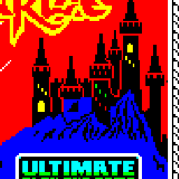

UNDERWURLDE
=====================
Faithful browser remake of the 1984 Ultimate Play The Game ZX Spectrum classic — work in progress.

## About
Released by Ultimate Play The Game in the last quarter of 1984 for the 48K ZX Spectrum, the middle
part of the Sabreman trilogy between Sabre Wulf and Knight Lore. Sabreman is trapped in a castle
and the caves beneath it — 597 screens of them — and has to reach one of three exits, each leading
into a different sequel. Its defining idea is that the monsters do not kill: they bounce him away,
and the only thing that kills is a long fall. The original game logic is being rewritten in
JavaScript from the original instructions and the disassembly of the game (not emulated) — see
`ZADANI.md` for the design and `MILNIKY.md` for the plan. Sibling projects: Manic Miner, Jet Set
Willy (same ZX platform and svision kernel), Cheeky Mouse, Stinger, Pleiads (arcade platform).

Status: **M6** — the game makes a noise, and it makes the right one. M5 had
answered what the world *does*; M6 answers what the machine *emits* — through
one bit of sound and one bit per pixel.

**Seven sounds and no music.** The whole program contains exactly four
`OUT ($FE),A` instructions and every one of them writes `$10` or `$00`, so two
long-standing questions fall out at once: the game plays **no music at all**,
and it never uses the border as an effect. What it has is seven effects driven
by one routine (`$A06A`: B is a half-period, C a count, so a period is
`26*B + 81` T states): a footstep on every fourth frame of walking, in two
pitches; a 2005 Hz blip for landing and for being knocked aside; a falling chirp
for jumping off and for picking something up; a bonk whose pitch is the y
coordinate of *whatever touched him*; a long slide down when something dies,
its length taken from the frame counter; a burst of noise made by clocking the
first 48 bytes of the ROM out of the speaker bit by bit; and one four-period
note for a shot hitting the floor — a routine that looks like a 64-step sweep
but ends its loop with `JP` where a `CALL` was meant, so only the first note is
ever heard. Firing, dying and changing rooms are silent, and so they are in the
remake. There is no MUSIC slider in the menu any more: an empty one would lie.

The sounds are not modelled. `data/sounds.json` holds the pulse trains
themselves, in Z80 T states, because that is all a one-bit beeper can produce —
`tools/dumpsound.py` lets the original's own routines play in the simulator and
writes down how long the bit was up and how long it was down, the same way
`data/rooms.json` holds the video memory the original's own routine drew.

**And three things about drawing.** The blitter **XORs** (`$97A5`), it does not
OR: that is how the original rubs a sprite out again, and it means a sprite
punches holes in the scenery it passes instead of covering it. Colour is not
painted cell by cell where the sprite has ink — `$9867` fills a whole
rectangle, `(height + 8 + ((~y) & 7)) >> 3` character rows tall, from the
sprite's bottom row upwards, so a sprite colours cells its pixels never reach.
And the castle furniture (`$79`–`$7E`) does not take its colour from the entity
record at all: `$EB39` looks its type up in a table at `$EB72` and `$E675`
copies a **block of attributes**, one byte per cell. That is the answer to the
old question about the two-coloured library in the start room. On the way,
`tools/matchsprites.js` also found the way out of the game — a wedge of ten
sprites — sitting sixteen pixels too far left.

Verification is the same discipline as M3, M4 and M5, sampled in two new
places. `tools/tracesound.py` plays the game and records **every write to port
$FE** with its T state, reading the return address off the stack at the first
pulse so each burst knows which routine played it; `tools/matchsound.js` replays
`app/beeper.js` — the code that ships to the browser — against it: **77 bursts,
4450 pulses, zero differences**. The one thing that cannot be reproduced is
reported rather than hidden: the original plays a sound *inside* the game step
with interrupts on, so a frame interrupt stretches whichever pulse it lands in
(71 of the 4450). `tools/tracescreen.py` copies the video memory of the running
original at the end of a full pass of its main loop, and `tools/matchsprites.js`
draws the same state with `app/screenComposer.js`: **17 frames, 11 968 cells, 33
that look different** — three cells of a colour trail the original left behind
and never cleaned up, and six cells where the rope line, which the original
plots with a division of its own, differs from Bresenham by a pixel. That last
one is written down as open, not rounded away.

## Play now
not deployed yet

## Requirements
- PHP 8.1+
- nginx
- MySQL / MariaDB
- Node.js + terser, for building the bundle (`npm i -g terser`)
- es-check, for the ES2018 compatibility gate in `svtool verify` (`npm i -g es-check`)
- Python 3 for the tools in `tools/` (no third-party packages; SkoolKit is vendored in
  `tools/vendor/`, see `tools/README.md`)

## Install
(`~/` below refers to the project root, not your home directory.)
- clone this repository
- clone library repository https://github.com/mitrenga/svision
- check symlink ~/app/svision
- configure nginx (example: ~/config/nginx.conf)
- create path ~/js with permissions 0777
- create database (script: ~/config/createDB.sql)
- create configuration file ~/config/config.php (example: ~/config/config.php.sample)
- build the production bundle: ~/app/svision/tools/svtool build bundle

## Build & tooling
The `svtool` CLI (`~/app/svision/tools/svtool`) builds and checks the deploy. Run it from the
project root:
- `svtool build bundle` — minified production bundle `js/bundle.<version>.min.js` (requires terser)
- `svtool build debug-bundle` — the same concatenation left unminified, `js/bundle.<version>.js`, for debugging on a device whose console cannot be opened
- `svtool verify` — check the `js/` deploy is complete, matches the current sources, and stays within ES2018
- `svtool info` — show the app version, deploy state and the most recent database records
- `svtool clean` — remove everything generated from `js/`

Project tools (`tools/`, Python 3 — details in `tools/README.md`):
- `mksnapshot.sh` — tape to snapshot and raw RAM images
- `mkruntime.py` — the **runtime** RAM image: the game moves its block one byte down after loading,
  so the tape image is offset against the running code. Everything else reads this one.
- `roomlib.py` — boots the game in the simulator and has **the original's own routine** draw any
  room; the shared base of the M2 tools
- `dumprooms.py` — the whole world: `data/world.json`, `data/rooms.json`, `data/room000.json`
- `dumpgfx.py` — the 20 backdrop blocks and the rules that compose a room, `data/scenery.json`
- `dumpsprites.py` — all 145 sprite types from the table at `$9332`, `data/spriteframes.json`
- `dumpentities.py` — **what stands in every room**: the castle's furniture table, the caves'
  rules and templates, the extra lives, the guardians, the weapon sets, `data/entities.json`
- `traceentities.py` / `matchentities.js` — record the original's room entry for all 598 rooms
  and replay the shipped `app/worldEntities.js` against it (zero differences)
- `dumpmonsters.py` — **what those entities do**: the monsters' movement, the weapons and their
  projectiles, the guardians and the score, `data/monsters.json`
- `dumpsound.py` — the seven sounds, as the pulse trains the original's own routines played in
  the simulator, `data/sounds.json`
- `tracesound.py` / `matchsound.js` — record the port $FE writes of the playing original and
  replay the shipped `app/beeper.js` against them (77 bursts, 4450 pulses, zero differences)
- `tracescreen.py` / `matchsprites.js` — copy the video memory of the playing original and draw
  the same state with the shipped `app/screenComposer.js`, cell by cell
- `dumptitle.py` — the title screen out of the running original, `data/title.json`; it also
  proves there is no attract mode (1300 frames, not a byte changes)
- `tracemonsters.py` / `matchmonsters.js` — record the original stopping on its type dispatch and
  replay the shipped `app/monsters.js` against it (6960 steps, 49 types, zero differences)
- `dumpphysics.py` / `tracephysics.py` / `matchphysics.js` — the same for Sabreman's own physics
  (1355 steps, zero differences)
- `runworker.js` / `renderframe.js` — drive the whole worker, and the whole render chain, headless
- `matchtransitions.js` — drive all 1222 transitions through the ported physics
- `checkworld.py` — the world graph: transitions, one-way sides, the three exits, reachability
- `matchscreen.py` — pixel-exact check of the remake's data against the original, room by room
- `mapworld.py` — the world map out of `data/`, and `--check` against the found screenshot map
- `playtrace.py` — runs the game in the simulator with scripted keys, saves frames and a coverage map
- `mkroom.py` — (M1, superseded by `dumprooms.py`) the static room by per-byte majority over frames
- `mksprite.py` — cuts a sprite out of a captured frame against that static room, into
  `data/sprites.json`. Nothing is drawn by hand.
- `mkfont.py` — the game's own character set from `$ED24` into `data/font.json`
- `mkscreen.py` — a ZX `.scr` into a data file (the loading screen, `data/loading.json`)
- `mkimages.py` — the web images and the favicon, cut from the original loading screen
- `scr2png.py`, `mapcut.py`, `dumpfont.py` — screen, world map and character set to PNG

## Data
`data/` holds what has been extracted from the original: the character set, the loading screen, the
whole world (`world.json`, 4.5 kB — the grid, one descriptor byte per room, one variant number per
room), the 100 distinct backdrops the 598 rooms are built from (`rooms.json`, fetched on demand,
108 kB over gzip), the blocks and composition rules that build any room from scratch
(`scenery.json`), what stands in every room (`entities.json`), what it does there
(`monsters.json`), the physics constants (`physics.json`), all 116 sprite frames with the
colour blocks of the castle furniture (`spriteframes.json`), the seven sounds as pulse trains
(`sounds.json`) and the title screen (`title.json`). Nothing is drawn by hand and
nothing is approximated — see `data/README.md` for the format, the reasoning and the verification.

## Sources
Reference material (the original instructions and inlay, the Crash review and player tips, period
maps, the screenshot map of the whole world, the loading screen, the hardware notes and the
measured screen geometry) lives in `sources/` — see `sources/README.md`. The tape image
(`sources/tape/`) is outside git; the rest of `sources/` is tracked.

## License
See the [LICENSE](LICENSE) file.
